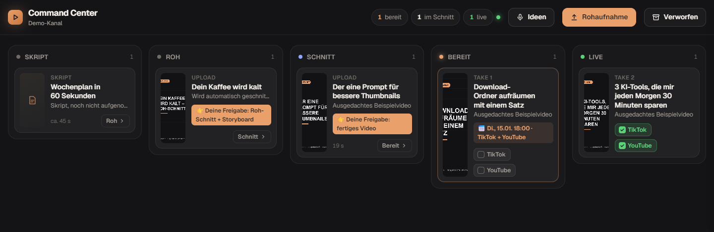
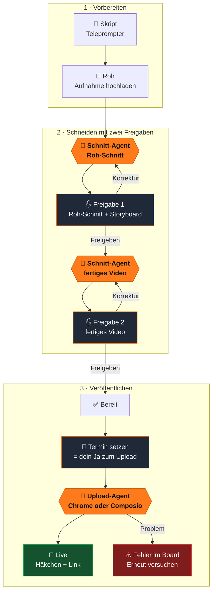
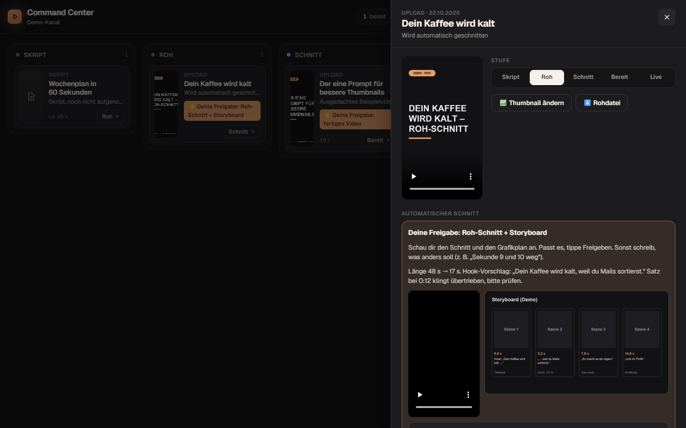
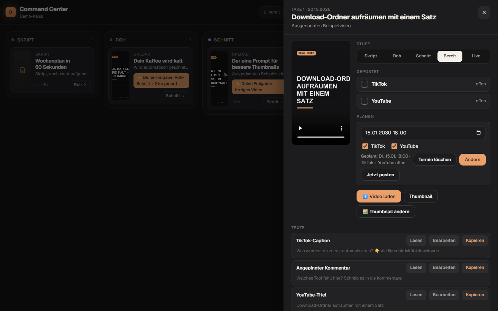

# Content Command Center

> **English summary:** A self-hosted content pipeline for short-form creators (TikTok, YouTube Shorts) instead of a paid scheduling tool.
> A local board (Python standard library + one HTML file) tracks every video from script to live. An MCP server lets Claude Code
> (or any MCP client) read and update the board. A small trigger watches the board without using any AI tokens and only starts
> `claude -p` when there is real work: a scheduled upload is due, or a raw recording waits to be edited. Edits go through two
> approval checkpoints in the board. German UI and docs. Ships with fictional demo data.

Eine eigene Content-Pipeline statt Abo-Tool: ein lokales Board, in dem jedes Video vom Skript bis „Live“ wandert,
und ein MCP-Server, über den Claude Code das Board lesen und bedienen kann. Agenten laufen nur, wenn es wirklich
etwas zu tun gibt.



## Ablauf



**Orange** = ein Agent arbeitet · **dunkel mit orangem Rand** = du entscheidest. Alles andere passiert im Board, am PC oder am Handy.

## Was es kann

| Bereich | Funktion |
|---|---|
| **Board** | Fünf Stufen (Skript → Roh → Schnitt → Bereit → Live), Karten mit Cover, Detailblatt, Handy-Ansicht mit Reitern, als Web-App installierbar |
| **Skript** | Texte je Video (Caption, Titel, Beschreibung, Tags, Sprechtext), Teleprompter mit einstellbarer Schrift, 1-Klick-Kopieren, eigene Fassungen ohne das Original zu verlieren |
| **Ideen** | Ideenspeicher mit Diktat (Web Speech API) |
| **Rohaufnahme** | Upload direkt aus dem Board (auch vom Handy, gestreamt, bis 8 GB), mehrere Anläufe pro Video |
| **Schnitt-Agent** | Zwei Freigaben im Board: Roh-Schnitt + Storyboard, dann fertiges Video. Korrekturen als Text, der Agent setzt nur diese um |
| **Planen** | Datum, Uhrzeit, Plattformen. Ein Termin ist das Ja zum Hochladen. Knopf „Jetzt posten“ |
| **Upload-Agent** | Lädt fällige Videos hoch (Claude in Chrome oder Composio), prüft Kanal und Konto, hakt erst nach Sichtprüfung ab |
| **Fehlerweg** | Sperre gegen Doppel-Uploads (45 Min.), Fehler rot auf der Karte, erneuter Versuch erst nach deinem Klick |
| **MCP** | 22 Werkzeuge für Claude Code, z. B. `board_uebersicht`, `faellige_uploads`, `einplanen`, `schnitt_auftraege`, `video_vorlegen` |
| **Agent-Auslöser** | Prüft ohne KI (0 Tokens), ob Arbeit da ist. Wird bei jeder Board-Änderung geweckt, sonst einmal pro Minute |

<table><tr>
<td></td>
<td></td>
</tr><tr>
<td align="center">Freigabe 1: Roh-Schnitt und Storyboard</td>
<td align="center">Planen, Texte kopieren</td>
</tr></table>

## Warum ein Auslöser statt Zeitplan?

Eine Routine, die alle 30 Minuten einen Agenten startet, endet meist mit „nichts fällig“ und kostet trotzdem jedes Mal eine
volle KI-Sitzung. Hier prüft ein kleiner Python-Thread den Stand ohne KI. Erst wenn ein Termin erreicht ist oder ein Schnitt
wartet, startet er `claude -p` mit dem passenden Auftrag aus `geplante-aufgaben/`. Pro Art läuft höchstens ein Agent, nach
einem Lauf gilt eine Pause (Standard 10 Minuten), die eine Änderung im Board aufhebt.

## Einrichtung

**Herunterladen:** oben auf dieser Seite **Code → Download ZIP** und entpacken, oder im Terminal:

```bash
git clone https://github.com/onursi/content-command-center-template.git
cd content-command-center-template
```

**Schnell:** Öffne Claude Code in diesem Ordner und kopiere den Text aus [`AGENT-SETUP.md`](AGENT-SETUP.md) hinein.
Der Agent richtet alles ein und fragt nach, was er wissen muss.

**Von Hand:**

1. **Voraussetzungen:** Python 3.10+, [Claude Code](https://docs.claude.com/en/docs/claude-code), optional ffmpeg (Thumbnails aus PNG/WebP, Schnitt).
2. **Abhängigkeit installieren:**
   ```bash
   python -m pip install -r requirements.txt
   ```
3. **Einstellungen:** `config.example.json` nach `config.json` kopieren und anpassen (Anzeigename, Kanalnamen, Medienordner).
   Optional `.env.example` nach `.env` kopieren (Port, Agent an/aus). Beide Dateien bleiben lokal.
4. **Board starten:**
   ```bash
   python server.py
   ```
   Dann http://127.0.0.1:8899 öffnen. Beim ersten Start werden die Demodaten aus `demo/` übernommen.
   Im Hintergrund ohne Fenster: `start.cmd` (Windows) oder `./start.sh` (macOS/Linux).
5. **MCP bei Claude Code anmelden** (absoluten Pfad einsetzen):
   ```bash
   claude mcp add --scope user kommandozentrale -- python /voller/pfad/zu/mcp_server.py
   ```
   Prüfen: `claude mcp list` zeigt `kommandozentrale` als verbunden.
6. **Testen** (Board muss laufen):
   ```bash
   python mcp_test.py
   ```
   Endet mit `ALLES OK`. Der Test ändert nur den Demo-Eintrag „skript-wochenplan“ und setzt ihn zurück.
7. **Agenten einschalten** (erst, wenn die Aufträge passen): Lies `geplante-aufgaben/upload.md` und `schnitt.md`,
   passe sie an deinen Ablauf an und setze in `config.json` `"agent": {"aktiv": true}`. Server neu starten.
   Der Upload-Agent (mit Chrome) bleibt zusätzlich aus, bis du bei `agent.arten.upload` `"aktiv": true` setzt.

### Eigene Videos eintragen

Inhalte stehen in `data.json` (Liste `items`), dein Stand aus dem Board in `state.json`. Ein Eintrag:

```json
{ "id": "mein-video", "titel": "…", "untertitel": "…", "take": "Take 1", "stage": "skript",
  "bild": "media_packages/cover.jpg", "video": "media_packages/fertig.mp4",
  "texte": [{ "name": "TikTok-Caption", "text": "…" }, { "name": "Teleprompter-Sprechtext", "text": "…", "prompter": true }] }
```

`media_packages/…` zeigt auf den Ordner, den du in `config.json` unter `medien.media_packages` einträgst.
Stufen: `skript`, `aufgenommen` (= Roh), `schnitt`, `bereit`, `live`. Videos aus dem Upload-Knopf legt der Server selbst an.

## Welcher Upload-Weg passt?

Ehrlich gesagt: **Vollautomatisch öffentlich posten klappt ohne Vorarbeit nur bei YouTube.** Bei TikTok entscheidet TikTok selbst,
ob deine App öffentlich posten darf. Darum gibt es drei Wege, die der Upload-Agent je nach Lage nimmt:

| Weg | YouTube | TikTok | Gut für | Haken |
|---|---|---|---|---|
| **A · Claude in Chrome** (Agent klickt im Studio) | ✅ öffentlich oder geplant | ✅ öffentlich | Start ohne eigene App | Datei höchstens ca. **10 MB**, Chrome muss offen und angemeldet sein |
| **B · Composio-Schnittstelle** | ✅ öffentlich oder geplant | ⚠️ nur **Entwurf im TikTok-Eingang** | große Dateien, PC muss nicht klicken | TikTok: du tippst am Handy nur noch auf „Posten“ und fügst die Caption ein |
| **C · Eigene TikTok-App** (geprüft) | – | ✅ öffentlich über die Schnittstelle | volle Automatik auf Dauer | einmalige Einrichtung und Prüfung durch TikTok, dauert Tage bis Wochen |

**Empfehlung zum Start:**
- **YouTube:** Weg A für kleine Shorts, Weg B ab 10 MB.
- **TikTok:** Videos unter 10 MB über Weg A, größere über Weg B als Entwurf. Dann bekommst du eine Mitteilung von TikTok,
  öffnest den Entwurf und tippst auf „Posten“. Die fertige Caption steht im Board zum Kopieren bereit.
- **Später:** Weg C einrichten, wenn du TikTok komplett ohne Handgriff willst. Anleitung: [docs/TIKTOK-APP.md](docs/TIKTOK-APP.md).

Tipp gegen die 10-MB-Grenze: Rechne mit höchstens etwa **1,3 Mbit/s** (Bild + Ton) für 60 Sekunden, bei 30 Sekunden das Doppelte.
Mit dem Codec **AV1** sehen Shorts bei dieser Rate meist noch sauber aus, YouTube nimmt AV1 an (für TikTok vorher mit einem Testvideo prüfen,
sonst H.265 nehmen). Beispiel mit ffmpeg:

```bash
ffmpeg -i fertig.mp4 -c:v libsvtav1 -preset 6 -b:v 1100k -c:a aac -b:a 96k upload.mp4
```

Prüf die Datei danach mit dem Auge. Der Agent komprimiert nie selbst, damit nichts ohne dein Wissen an Qualität verliert.

## Aufbau

| Datei | Aufgabe |
|---|---|
| `server.py` | Liefert das Board aus, streamt Videos, speichert den Stand, nimmt Uploads an. Nur Standardbibliothek |
| `index.html` | Die ganze Oberfläche, ohne Build-Schritt |
| `mcp_server.py` | MCP „kommandozentrale“ (offizielles `mcp`-SDK, stdio). Spricht über HTTP mit dem laufenden Server |
| `agent_ausloeser.py` | Thread im Server: prüft ohne KI und startet `claude -p` nur bei Arbeit |
| `einstellungen.py` | Liest `config.example.json`, `config.json` und `.env` |
| `geplante-aufgaben/*.md` | Aufträge für Upload- und Schnitt-Agent. Platzhalter wie `{{YOUTUBE_KANAL}}` kommen aus `config.json` |
| `demo/` | Ausgedachte Beispielvideos und `erzeugen.py`, das sie neu baut |

## Sicherheit

Das Board hat kein Login. Diese Schutzmaßnahmen sind eingebaut:

- **Nur erlaubte Hosts:** Der Server beantwortet nur Anfragen an `127.0.0.1`, `localhost` und die Namen in
  `sicherheit.erlaubte_hosts` (bzw. `CCC_ERLAUBTE_HOSTS`). Andere Host-Header bekommen 403. Das verhindert DNS-Rebinding.
  Nutzt du einen privaten Tunnel (z. B. Tailscale), trag dessen Namen dort ein, sonst lädt das Board am Handy nicht.
- **Schreiben nur vom eigenen Board:** POST-Anfragen mit fremdem `Origin`/`Referer` werden abgewiesen (403).
  Die JSON-Routen (`/api/state`, `/api/item`, `/api/ideen`) verlangen `Content-Type: application/json` (sonst 415),
  damit eine fremde Webseite nicht mit einem einfachen Formular Daten einschleusen kann.
- **Geteiltes Token:** Beim ersten Start legt der Server ein zufälliges Token in `.ccc-token` ab (nicht eingecheckt).
  Board, MCP und Auslöser senden es bei jedem POST als `X-CCC-Token`. Abschalten mit `"sicherheit": {"token": false}`.
- **Nur freigegebene Dateien:** Ausgeliefert werden das Board, die Icons, `data.json` und die Medienordner aus `config.json`,
  nie `.env`, `config.json`, `.ccc-token` oder Code. Pfade wie `../` werden abgefangen.
- **Texte werden escaped:** Titel, Texte, Ideen, Korrekturen und Notizen kommen nie als HTML ins Board, Links nur mit http(s).
- **Agent eingeschränkt:** Der Auslöser startet `claude -p` mit `--permission-mode dontAsk` und `--allowedTools`
  (siehe unten). Ein Lauf, der länger als `agent.max_laufzeit_minuten` (Standard 180) braucht, wird beendet und im Board als Fehler gezeigt.
- Der Arbeitsordner des Schnitt-Agenten wird geprüft: Er muss unter `media_auto` liegen.

Danke an das Community-Review, das mehrere dieser Punkte gefunden hat.

## Ehrliche Grenzen

- **Der Auslöser startet `claude -p` ohne Rückfragen.** Statt `--dangerously-skip-permissions` steht in `config.example.json`
  eine Liste erlaubter Werkzeuge (`agent.erlaubte_werkzeuge` → `--allowedTools`): die `kommandozentrale`-Werkzeuge
  (`mcp__kommandozentrale__*`), `Bash(ffmpeg:*)`, `Bash(ffprobe:*)`, `Bash(python:*)`, `Read`, `Write` und `Edit`.
  Alles andere lehnt `--permission-mode dontAsk` ab. Der Upload-Agent bekommt zusätzlich die Chrome-Werkzeuge und ist standardmäßig aus.
  Braucht dein Schnitt mehr (z. B. `node`), ergänze nur genau diese Befehle. Der Auslöser ist standardmäßig **aus**.
  Jeder Lauf kostet Tokens deines Claude-Kontos.
- **Ein Agent lädt alle MCP-Server aus deinem Benutzer-Profil** (User-Scope), nicht nur `kommandozentrale`. Hast du dort
  z. B. E-Mail, Kalender oder Bezahldienste angebunden, kann der Agent sie sehen. Darum `--allowedTools` nutzen (siehe oben)
  oder den Auslöser unter einem eigenen Windows-/macOS-Benutzer laufen lassen, der nur die nötigen MCPs hat.
- **Arbeitsverzeichnis und `.env` trennen:** `agent.arbeitsverzeichnis` steht auf `arbeit/`, nicht auf dem Programmordner.
  So liegen `.env`, `config.json` und `.ccc-token` nicht im Ordner, in dem der Agent arbeitet. Leg dort keine Zugangsdaten ab.
- `python` ist erlaubt, damit der Schnitt Skripte ausführen kann. Ein Python-Skript kann alles, was dein Benutzer darf.
  Wer das nicht will, streicht `Bash(python:*)` und gibt dem Agenten nur feste Skripte frei.
- **TikTok-API:** Ohne App-Prüfung durch TikTok gibt es kein öffentliches Posten über die Schnittstelle. Über Composio
  (`TIKTOK_UPLOAD_VIDEO`, `publish: false`) landet das Video nur im TikTok-Eingang, die Caption muss man in der App einsetzen.
  Eigene App einrichten: [docs/TIKTOK-APP.md](docs/TIKTOK-APP.md).
- **YouTube-API:** Uploads über die Schnittstelle zählen gegen ein Tageskontingent. Ist es aufgebraucht, scheitert der Upload bis zum nächsten Tag.
- **Claude in Chrome:** Der Browser-Weg braucht ein offenes Chrome mit der Erweiterung und angemeldeten Konten.
  Das Datei-Werkzeug nimmt höchstens etwa 10 MB; größere Videos meldet der Agent als Fehler, statt sie zu komprimieren.
  Oberflächen von TikTok und YouTube ändern sich, dann muss der Auftrag angepasst werden.
- **Schnitt-Agent:** Der mitgelieferte Auftrag ist ein Gerüst. Gute Ergebnisse brauchen deine eigenen Regeln (Stil, Grafik, Untertitel),
  einen Transkribierer wie faster-whisper und Rechenleistung. Er legt nur vor, gibt nie selbst frei und postet nie.
- **Kein Login im Board.** Der Server hört standardmäßig nur auf `127.0.0.1`. Fürs Handy einen privaten Tunnel nutzen
  (z. B. Tailscale) und dessen Namen in `sicherheit.erlaubte_hosts` eintragen, nie offen ins Internet stellen.
  Wer das Board im Tunnel öffnen kann, kann auch das Token lesen: Der Tunnel muss privat bleiben.
- Einzelnutzer-Werkzeug, getestet unter Windows 11 mit Python 3.12. macOS/Linux sollten laufen, sind aber weniger erprobt.

## Lizenz

MIT, siehe [LICENSE](LICENSE).
